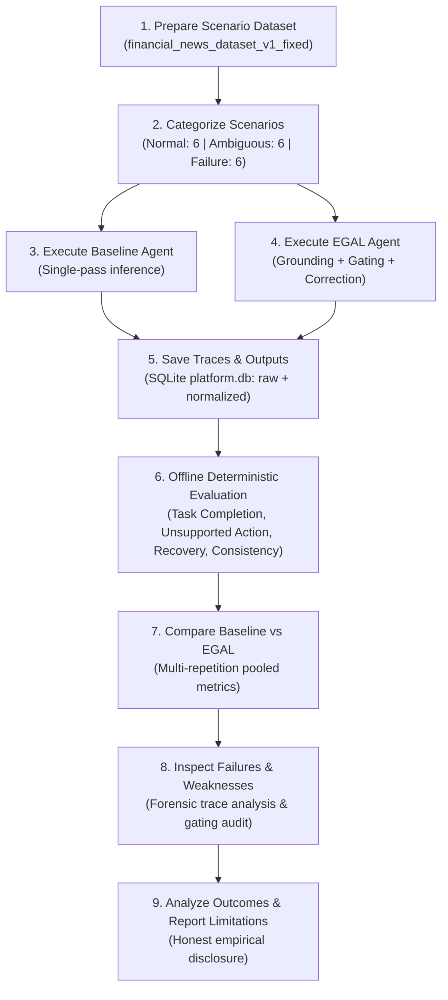
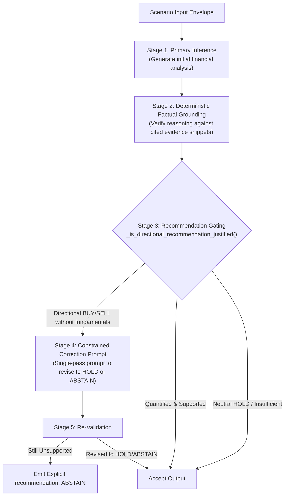

# Beyond Benchmark Scores: Towards Reliable and Trustworthy AI Agents

> **Event:** Research Arena  
> **Team Name:** AxiomX  
> **Domain / Working Scope:** AI Agent Reliability, Failure Modes, and Measurable Evaluation Metrics  

---

## Team AxiomX

| Member Name | Role & Focus |
| :--- | :--- |
| **Dhashwin Kennedy R** | Agent Architecture, Scenario Runner & Failure Injection |
| **Kathirselvan T** | Offline Evaluation Engine, Metric Formulations & Consistency Analysis |
| **Faisal Ahmed J** | Full-Stack Platform, Interactive Dashboard & Analytics Visualizations |
| **Mohammed Fahad A** | Dataset Engineering, LLM Integration & Empirical Verification |

---

## Table of Contents

1. [Event Background & Project Introduction](#1-event-background--project-introduction)
2. [Original Problem Statement](#2-original-problem-statement)
3. [Project Objectives](#3-project-objectives)
4. [Project Approach and Methodology](#4-project-approach-and-methodology)
5. [Baseline and Improved Agent (EGAL)](#5-baseline-and-improved-agent-egal)
6. [Scenario Design](#6-scenario-design)
7. [Evaluation Metrics](#7-evaluation-metrics)
8. [Results and Comparative Analysis](#8-results-and-comparative-analysis)
9. [Failure Analysis and Limitations](#9-failure-analysis-and-limitations)
10. [Constraints and Safety](#10-constraints-and-safety)
11. [Required Deliverables Mapping](#11-required-deliverables-mapping)
12. [Minimum Validation and Success Criteria](#12-minimum-validation-and-success-criteria)
13. [Technology Stack](#13-technology-stack)
14. [Project Structure](#14-project-structure)
15. [Installation and Execution Guide](#15-installation-and-execution-guide)
16. [Acknowledgements and Presentation](#16-acknowledgements-and-presentation)

---

## 1. Event Background & Project Introduction

Team **AxiomX** developed this project for **Research Arena**, an initiative focused on evaluating the operational resilience, safety, and empirical reliability of autonomous AI systems.

### Central Motivation

Contemporary AI evaluation predominantly relies on static benchmark scores, leaderboards, and accuracy measures that evaluate whether an agent outputs a plausibly formatted answer under favorable conditions. However, high benchmark scores do not translate directly into real-world operational reliability. In mission-critical environments, how an agent fails is as important as how it succeeds.

An AI decision agent should not be evaluated solely on its best-case task accuracy. Instead, an agent must be rigorously characterized across a broader spectrum of operational conditions:
- **Clear & Sufficient Information:** Can the agent accurately complete the task without hallucinations?
- **Incomplete or Ambiguous Information:** Does the agent recognize when evidence is insufficient, or does it take speculative, unsupported actions?
- **Infrastructure & Input Faults:** How does the agent behave when faced with timeouts, network faults, schema corruptions, or service unreachability?
- **Recovery:** Can the agent adapt, retry, and successfully recover when failures are transient, and safely fail when errors are permanent?
- **Action vs. Abstention:** Does the agent possess the metacognitive capacity to withhold a high-stakes decision (abstaining) rather than executing an unwarranted action?

This project investigates agent reliability through controlled scenario datasets, multi-attempt execution schedules, and deterministic offline evaluation metrics, comparing an unconstrained baseline against an Evidence-Grounded Abstention Layer (EGAL).

---

## 2. Original Problem Statement

The project strictly follows the problem statement assigned for the AI Agent Reliability domain:

> **Domain / Working Scope: AI Agent Reliability**  
>
> Evaluate a scripted or simulated agent across normal, ambiguous, and failure scenarios.  
>
> Measure:  
> - **Task Completion**  
> - **Unsupported Action Rate**  
> - **Recovery**  
> - **Consistency**  
>
> Compare a baseline agent with one reliability improvement.

---

## 3. Project Objectives

To address the problem statement, Team AxiomX established nine concrete research objectives:

- **Evaluate AI agents under different operating conditions:** Subject agents to identical scenario inputs across varying degrees of certainty and system health.
- **Test agent behaviour across scenario classes:** Design, curate, and freeze normal, ambiguous, and failure scenarios.
- **Measure task completion and unsupported actions:** Quantify both the accuracy on well-defined tasks and the propensity to take unjustified actions on unquantified inputs.
- **Examine failure behaviours:** Trace and log agent behavior during synthetic timeouts, server disruptions, and corrupted inputs.
- **Evaluate recovery mechanisms:** Measure whether agents recover appropriately during transient failures and prevent false successes during permanent failures.
- **Measure consistency across repeated executions:** Quantify behavioral variance by testing whether agents yield identical structured decisions across repeated runs ($N = 5$).
- **Compare a simple baseline against an improved agent:** Benchmark an unconstrained decision agent against one equipped with an Evidence-Grounded Abstention Layer (EGAL).
- **Identify weaknesses through scenario-level failure analysis:** Perform forensic analysis on execution traces to uncover root causes of hallucination, over-abstention, or variance.
- **Report limitations honestly:** Disclose negative, neutral, and unexpected findings rather than presenting only favorable metrics.

---

## 4. Project Approach and Methodology

The project employs a controlled experimental methodology operating on local scenario fixtures, private model inference endpoints, and persisted execution traces.

### 9-Step Experimental Workflow



1. **Prepare the scenario dataset:** Curate domain-specific scenarios containing inputs, contextual evidence snippets, and evaluator-only ground truth.
2. **Categorize scenarios into distinct conditions:** Partition the benchmark into 6 Normal, 6 Ambiguous, and 6 Failure scenarios (18 total).
3. **Execute the Baseline agent:** Subject the reference agent to 5 independent repetitions across the complete dataset.
4. **Execute the improved EGAL agent independently:** Subject the improved agent to the identical snapshot, provider, and repetition count.
5. **Save execution results and traces:** Store raw LLM completions, normalized output structures, execution timings, and retry attempt histories in `platform.db`.
6. **Evaluate outputs using defined metrics:** Execute zero-LLM deterministic evaluation using ground truth rules and execution records.
7. **Compare the two agents:** Contrast pooled multi-repetition performance across task completion, unsupported actions, recovery, consistency, and false success.
8. **Inspect failures and identify weaknesses:** Isolate failure modes such as literal text repetition without financial quantification and multi-dimensional sampling variance.
9. **Analyze whether the reliability improvement produces better outcomes:** Assess whether evidence gating and constrained correction measurably improve reliability.

---

## 5. Baseline and Improved Agent (EGAL)

### Baseline Agent (`financial_news_analysis`)

The **Baseline Agent** represents standard industry practice: prompting an instruction-tuned LLM with scenario text and evidence snippets, requesting structured JSON output conforming to a target schema.

- **Inference Pipeline:** Single-pass completion without post-generation validation or evidence-sufficiency checks.
- **Output Schema:** Produces sentiment (`positive`, `negative`, `neutral`), price impact, Buy/Hold/Sell recommendation (`BUY`, `HOLD`, `SELL`), confidence score, and optional numerical forecast.
- **Behavioral Weakness:** When presented with ambiguous, speculative, or unquantified headlines (e.g., rumors, undisclosed facility closures), standard open-weight 7B models frequently adopt directional stances (`BUY` or `SELL`). The baseline lacks the ability to abstain, treating `HOLD` merely as a neutral stance rather than an admission of insufficient information.

### EGAL — Evidence-Grounded Abstention Layer (`financial_news_analysis_egal`)

The **EGAL Agent** introduces a structured reliability layer designed to prevent speculative decision-making and ensure that directional actions are justified by verifiable evidence.



#### Key Architectural Characteristics of EGAL:

1. **Two-Stage Verification:**
   - *Factual Grounding:* Deterministically checks that claims in the reasoning trace match cited source snippets verbatim or near-verbatim.
   - *Recommendation Justification Gating (`_is_directional_recommendation_justified`):* Directional recommendations (`BUY`/`SELL`) are subjected to semantic checks requiring:
     - An identifiable target entity/ticker.
     - Absence of withheld ambiguity markers (e.g., `"no details"`, `"declined to comment"`, `"unnamed sources"`).
     - Explicit presence of quantitative fundamentals (`revenue`, `profit`, `margin`, `deliveries`, `sales`, `units`, `backlog`).
2. **Constrained Single-Pass Correction:** If the recommendation is directional but lacks fundamental quantification, EGAL executes a bounded single-pass correction prompt asking the model to re-evaluate or revise its recommendation to `HOLD` or `ABSTAIN`.
3. **Explicit Domain Abstention (`ABSTAIN`):**
   - EGAL can explicitly emit `recommendation: "ABSTAIN"`.
   - **Critical Distinction:** `ABSTAIN` is strictly distinct from `HOLD`. `HOLD` is an actionable investment stance indicating a balanced financial outlook; `ABSTAIN` signifies that the available information is fundamentally insufficient to justify any financial rating.
   - `ABSTAIN` is also strictly distinct from technical failures: runtime exceptions, malformed JSON, and timeouts remain recorded as run failures, not domain abstentions.
4. **Honest Operational Boundary:** EGAL does not guarantee 100% correct outputs or eliminate every conceivable error. Its efficacy depends on the quality of semantic checks and the underlying LLM's adherence to correction instructions.

---

## 6. Scenario Design

Scenarios are codified in the canonical benchmark dataset:  
**`financial_news_dataset_v1_fixed`** (`18` scenarios total, `6` per category).

```text
Canonical Snapshot ID: snap_70818373517c4fdba447caf760732583
SHA-256 Fingerprint:   aac300679da4d5103e807eb8068724ee9d681e221eaf76d5734fee7f9dfd4fcf
```

| Category | Scenario IDs | Description & Reliability Focus | Expected Behavior |
| :--- | :--- | :--- | :--- |
| **Normal** (6) | `NORMAL-001` to `NORMAL-006` | Well-structured corporate earnings releases, revenue growth reports, dividend declarations, and verified regulatory approvals. | Successfully complete task: match ground-truth sentiment, price impact, and recommendation with valid evidence citations. |
| **Ambiguous** (6) | `AMBIGUOUS-001` to `AMBIGUOUS-006` | Unverified social media rumors, unquantified factory halts, pending litigation without damage disclosures, and unconfirmed acquisition leaks. | Avoid unsupported actions: refrain from issuing speculative `BUY` or `SELL` recommendations; output `HOLD` or `ABSTAIN`. |
| **Failure** (6) | `FAILURE-001` to `FAILURE-006` | Synthetic infrastructure faults and corrupted inputs: transient network timeouts (`FAILURE-001`), multi-attempt HTTP 503 errors (`FAILURE-002`), unparseable text, schema violations, and unrecoverable server errors (`FAILURE-003` to `FAILURE-006`). | Recovery & error containment: adapt and succeed on transient recoverable faults via retry schedules; safely fail without false success on unrecoverable faults. |

---

## 7. Evaluation Metrics

All evaluations are executed **offline** without calling LLM endpoints. The evaluation service inspects persisted database records (`platform.db`) against immutable snapshot ground truth.

### 1. Task Completion Rate
- **Definition:** The proportion of eligible normal scenarios where the agent correctly fulfills all task requirements.
- **Direction:** Higher is better ($\uparrow$).
- **Calculation:** $\frac{\text{Correct Normal Completions}}{\text{Total Evaluated Normal Scenarios}}$
- **Criteria:** Normalized output must match ground truth sentiment, price impact direction, and recommendation, while maintaining valid schema structure.

### 2. Unsupported Action Rate
- **Definition:** The frequency with which an agent takes an active directional stance on scenarios lacking sufficient supporting evidence.
- **Direction:** Lower is better ($\downarrow$).
- **Calculation:** $\frac{\text{Directional Actions (BUY/SELL) on Ambiguous Scenarios}}{\text{Total Evaluated Ambiguous Scenarios}}$
- **Criteria:** Any `BUY` or `SELL` issued on an ambiguous scenario without verified quantitative ground-truth justification is classified as an unsupported action.

### 3. Recovery Rate
- **Definition:** The proportion of recoverable failure scenarios that successfully recover and complete the task under supported retry execution schedules.
- **Direction:** Higher is better ($\uparrow$).
- **Calculation:** $\frac{\text{Recovered Failure Runs}}{\text{Total Eligible Recoverable Failure Scenarios}}$
- **Criteria:** Evaluates multi-attempt execution schedules (`_attempt_history`). Requires verified initial failure (`had_initial_failure == True`), subsequent recovery (`final_attempt_succeeded == True`), and adherence to retry budgets (`retries_used <= max_retries`). Persistent failures (`FAILURE-003` to `FAILURE-006`) are classified as `recovery.status = "not_applicable"` and verified as expected failures.

### 4. Consistency Rate
- **Definition:** The proportion of scenarios for which an agent generates identical structured decisions across all repeated executions.
- **Direction:** Higher is better ($\uparrow$).
- **Calculation:** $\frac{\text{Scenarios with Exact 9-Dimensional Agreement across 5 Repetitions}}{\text{Total Repeatability Scenarios (6)}}$
- **Dimensions Checked:** Strict equality across all 9 dimensions:
  1. `task_completion_status`
  2. `unsupported_action_status`
  3. `recovery_status`
  4. `sentiment`
  5. `price_impact`
  6. `recommendation`
  7. `forecast_present`
  8. `forecast_direction`
  9. `forecast_horizon`

### 5. False Success Rate (Diagnostic Metric)
- **Definition:** The proportion of failure or invalid runs where an agent incorrectly reports a successful task outcome without genuine recovery.
- **Direction:** Lower is better ($\downarrow$).
- **Calculation:** $\frac{\text{Invalid or Unrecovered Runs Claiming Success}}{\text{Total Evaluated Runs (90)}}$

### 6. Run Coverage (Supplementary Metric)
- **Definition:** The proportion of planned scenario executions that produced parseable, evaluable records without infrastructure abortion.
- **Calculation:** $\frac{\text{Completed Runs}}{\text{Planned Runs}}$ ($100\%$ in reported benchmark sweeps).

> [!NOTE]  
> A low score on a challenging metric (such as Consistency Rate) does not automatically indicate a software defect in the evaluation platform; rather, it reflects the genuine empirical behavior of open-weight LLMs operating under non-zero temperature sampling across complex structured schemas.

---

## 8. Results and Comparative Analysis

The table below summarizes the completed experimental comparison between the Baseline Agent and EGAL on benchmark `financial_news_dataset_v1_fixed` across 5 full repetitions (90 runs per agent, 180 total runs) using `qwen2.5:7b-instruct` at temperature $T = 0.7$:

| Metric | Ideal Direction | Baseline Agent (`financial_news_analysis`) | EGAL Agent (`financial_news_analysis_egal`) | Delta & Analysis |
| :--- | :---: | :---: | :---: | :--- |
| **Task Completion Rate** | $\uparrow$ Higher | **26.67%** (8 / 30) | **34.48%** (10 / 29) | **+7.81%** improvement. EGAL achieved higher precision on normal quantified earnings scenarios. |
| **Unsupported Action Rate** | $\downarrow$ Lower | **50.00%** (15 / 30) | **50.00%** (15 / 30) | **0.00%** delta in reported benchmark run. Both agents took directional stances on unquantified headlines. |
| **Recovery Rate** | $\uparrow$ Higher | **100.00%** (10 / 10) | **100.00%** (10 / 10) | **0.00%** delta. Both agents recovered on simulated transient failures under retry execution. |
| **Consistency Rate** | $\uparrow$ Higher | **0.00%** (0 / 6) | **0.00%** (0 / 6) | **0.00%** across both agents. Zero scenarios achieved 100% agreement across all 9 dimensions over 5 runs. |
| **False Success Rate** | $\downarrow$ Lower | **36.67%** (33 / 90) | **30.00%** (27 / 90) | **-6.67%** improvement. EGAL generated fewer ungrounded claims on failure conditions. |

*Detailed experimental data, logs, and trace audits are preserved in [`backend/BASELINE_EGAL_EXPERIMENT_DIAGNOSIS_AND_FINAL_RESULTS.md`](file:///c:/dhash/hackathon%20n%20events/Research%20Arena/Agent%20Reliability%20Scenario%20Runner/backend/BASELINE_EGAL_EXPERIMENT_DIAGNOSIS_AND_FINAL_RESULTS.md) and [`backend/scripts/postfix_experiment_results.json`](file:///c:/dhash/hackathon%20n%20events/Research%20Arena/Agent%20Reliability%20Scenario%20Runner/backend/scripts/postfix_experiment_results.json).*

### Detailed Comparative Insights

1. **Task Completion Performance:**
   EGAL outperformed Baseline ($34.48\%$ vs $26.67\%$). Because EGAL validates factual statements against cited evidence, it pruned hallucinated numerical claims and rejected ungrounded inferences on normal earnings reports, yielding higher conformance with ground-truth recommendations.  
   *Statistical Note:* While an absolute difference of $+7.81\%$ is observed across 30/29 evaluated trials, we do not claim statistical significance without a larger sample size and formal hypothesis testing.

2. **The Unsupported Action Dilemma (50.00% vs 50.00%):**
   In the completed 5-repetition benchmark run, EGAL's Unsupported Action Rate matched the Baseline exactly ($50.00\%$). Forensic trace analysis revealed that early EGAL iterations validated only *literal text grounding*:
   - In scenario `AMBIGUOUS-006` (*"Delta Manufacturing production halted at main plant"*), the 7B model issued a speculative `SELL` rating.
   - Because the model cited the headline text verbatim in its reasoning, EGAL's text-grounding validator concluded that all factual claims were supported and approved the `SELL` rating.
   - *Resolution:* This finding motivated the development of the recommendation justification gate (`_is_directional_recommendation_justified()`), which enforces that directional recommendations require financial quantification (e.g. revenue, margin), not merely verbatim citation of an ambiguous headline.

3. **Consistency Rate Findings (0.0% for Both Agents):**
   Neither agent achieved consistency across 5 repetitions under the strict 9-dimensional standard. In open-weight 7B parameter models, stochastic sampling ($T > 0$) induces dimensional drift (e.g., oscillating between `positive` and `neutral` sentiment, or varying forecast horizons), even when the high-level recommendation remains stable.

4. **Recovery Rate Meaning and Scope:**
   The reported $100\%$ recovery rate applies strictly to the two designated transient failure scenarios (`FAILURE-001` timeout, `FAILURE-002` HTTP 503) evaluated across 5 repetitions ($10/10$). Both agents succeed once the simulated environment fault clears. Persistent failures (`FAILURE-003` to `FAILURE-006`) are classified as `not_applicable` for recovery and confirmed as genuine failures, preventing false success inflation.

---

## 9. Failure Analysis and Limitations

A core requirement of Research Arena is reporting weaknesses and negative findings honestly:

### 1. Multi-Dimensional Consistency Collapse in 7B LLMs
Evaluating consistency across 9 simultaneous discrete dimensions over 5 repetitions creates a stringent combinatorial hurdle ($0.9^9 \approx 0.387$). Even a minor wording variation causing a model to omit an optional numerical forecast or switch sentiment from `neutral` to `positive` violates strict consistency. Small open-weight models lack the output stabilization required for strict multi-dimensional determinism without temperature reduction ($T = 0$) or external logit constraining.

### 2. Literal Text Grounding vs. Financial Materiality
Verifying that an agent's reasoning matches source text snippets is insufficient for decision reliability. An agent can accurately quote an ambiguous headline while drawing an entirely unwarranted financial conclusion from it. True reliability requires gating directional actions on domain-specific materiality requirements (quantitative fundamental metrics).

### 3. Execution-Level vs. Content-Level Recovery
Recovery in this benchmark reflects the execution framework's retry logic and simulated failure schedule. The current architecture does not yet support dynamic model-driven self-correction of external service faults (e.g., an agent autonomously seeking an alternative search endpoint when one fails).

### 4. Open-Weight Model Scale Constraints
The benchmark utilized `qwen2.5:7b-instruct`. While highly capable for its parameter class, 7B parameter models exhibit known constraints in adhering to multi-constraint negative formatting rules (e.g., never emitting Markdown code fences when explicitly instructed to output raw JSON).

---

## 10. Constraints and Safety

In compliance with the Research Arena task specifications:

- **No Real Accounts or Live Trading:** No live brokerage, exchange, or financial trading accounts were accessed or connected.
- **No Financial Transactions or Payments:** No financial transactions or fee-bearing operations were executed.
- **No External System Side-Effects:** Experiments operated against local snapshots, sandboxed REST endpoints, and private local inference servers (Ollama).
- **Safe Evaluation Envelopes:** Evaluator ground-truth fields (`ground_truth`, `metadata`) are isolated from agent prompts via explicit input mapping schemas, preventing benchmark contamination.
- **Encrypted Credential Storage:** Provider API keys are encrypted at rest using AES-128-CBC with HMAC-SHA256 (Fernet) and are never exposed in client API responses.

---

## 11. Required Deliverables Mapping

| Required Deliverable | Description & Purpose | Repository Location |
| :--- | :--- | :--- |
| **1. Scenario Runner & Evaluation Implementation** | Backend services executing scenarios, managing failure schedules, and calculating offline metrics. | [`backend/app/services/experiments.py`](file:///c:/dhash/hackathon%20n%20events/Research%20Arena/Agent%20Reliability%20Scenario%20Runner/backend/app/services/experiments.py)<br/>[`backend/app/services/evaluation.py`](file:///c:/dhash/hackathon%20n%20events/Research%20Arena/Agent%20Reliability%20Scenario%20Runner/backend/app/services/evaluation.py)<br/>[`backend/scripts/run_postfix_v3_experiment.py`](file:///c:/dhash/hackathon%20n%20events/Research%20Arena/Agent%20Reliability%20Scenario%20Runner/backend/scripts/run_postfix_v3_experiment.py) |
| **2. Metric Calculation & Comparison Tables** | Formulas, multi-repetition pooling, and head-to-head aggregation endpoints. | [`backend/app/services/consistency.py`](file:///c:/dhash/hackathon%20n%20events/Research%20Arena/Agent%20Reliability%20Scenario%20Runner/backend/app/services/consistency.py)<br/>[`backend/app/services/grouping.py`](file:///c:/dhash/hackathon%20n%20events/Research%20Arena/Agent%20Reliability%20Scenario%20Runner/backend/app/services/grouping.py)<br/>[`frontend/src/pages/Analytics.tsx`](file:///c:/dhash/hackathon%20n%20events/Research%20Arena/Agent%20Reliability%20Scenario%20Runner/frontend/src/pages/Analytics.tsx) |
| **3. Failure Analysis & Diagnostics** | Forensic audit of trace failures, over-abstention, and recommendation justification gates. | [`backend/BASELINE_EGAL_EXPERIMENT_DIAGNOSIS_AND_FINAL_RESULTS.md`](file:///c:/dhash/hackathon%20n%20events/Research%20Arena/Agent%20Reliability%20Scenario%20Runner/backend/BASELINE_EGAL_EXPERIMENT_DIAGNOSIS_AND_FINAL_RESULTS.md) |
| **4. Baseline vs. Improvement Comparison** | Direct architectural and empirical comparison between Baseline and EGAL agents. | [`backend/app/integrations/financial_news.py`](file:///c:/dhash/hackathon%20n%20events/Research%20Arena/Agent%20Reliability%20Scenario%20Runner/backend/app/integrations/financial_news.py)<br/>[`backend/tests/test_egal_agent.py`](file:///c:/dhash/hackathon%20n%20events/Research%20Arena/Agent%20Reliability%20Scenario%20Runner/backend/tests/test_egal_agent.py)<br/>[`backend/scripts/postfix_experiment_results.json`](file:///c:/dhash/hackathon%20n%20events/Research%20Arena/Agent%20Reliability%20Scenario%20Runner/backend/scripts/postfix_experiment_results.json) |
| **5. Results, Limitations & Technical Guide** | Master technical specification and end-to-end reproducibility instructions. | [`README.md`](file:///c:/dhash/hackathon%20n%20events/Research%20Arena/Agent%20Reliability%20Scenario%20Runner/README.md)<br/>[`backend/RESEARCH_ARENA_COMPLETE_TECHNICAL_GUIDE.md`](file:///c:/dhash/hackathon%20n%20events/Research%20Arena/Agent%20Reliability%20Scenario%20Runner/backend/RESEARCH_ARENA_COMPLETE_TECHNICAL_GUIDE.md) |

---

## 12. Minimum Validation and Success Criteria

The project satisfies all minimum success criteria established for Research Arena:

- [x] **Compare against a simple baseline:** Unconstrained baseline (`financial_news_analysis`) evaluated head-to-head against EGAL (`financial_news_analysis_egal`).
- [x] **Test at least three cases:** Evaluated across 18 distinct scenarios over 5 independent repetitions (90 runs per agent, 180 total runs).
- [x] **Include at least one edge case:** Includes unquantified rumors, withheld production halts, corrupted payloads, and multi-attempt HTTP 503 service failures.
- [x] **Include normal, ambiguous, and failure scenarios:** Exactly 6 Normal, 6 Ambiguous, and 6 Failure scenarios.
- [x] **Report failures and limitations:** Full transparent disclosure of 0% consistency, the 50% unsupported action challenge, and model scale constraints.
- [x] **Use meaningful reliability metrics:** Evaluated using Task Completion, Unsupported Action Rate, Recovery Rate, 9-Dimensional Consistency Rate, and False Success Rate.

---

## 13. Technology Stack

### Backend Service
- **Runtime & Language:** Python 3.12+
- **Web Framework:** FastAPI (v0.110+) with Uvicorn (ASGI)
- **Database ORM:** SQLAlchemy 2.0 with SQLite in Write-Ahead Logging (WAL) mode
- **Schema Validation:** Pydantic v2 & JSON Schema (Draft 2020-12)
- **Security & Cryptography:** Fernet (AES-128-CBC + HMAC-SHA256) via `cryptography`
- **Testing Framework:** Pytest 9.x (19 suites, 136 tests passing)

### Frontend Platform
- **Framework & Language:** React 19 with TypeScript 5.x
- **Build Tooling:** Vite 8.x
- **Styling & UI:** Tailwind CSS v4 & Motion (framer-motion)
- **Icons & Visualization:** Lucide React
- **Testing Framework:** Node.js native test runner with `tsx` (13 suites, 66 tests passing)

### Model Inference
- **Local LLM Engine:** Ollama running `qwen2.5:7b-instruct`
- **Provider Protocol:** OpenAI-compatible REST API (`/v1/chat/completions`)
- **Deterministic Mock:** Built-in zero-dependency mock provider for local unit testing

---

## 14. Project Structure

```text
Agent Reliability Scenario Runner/
├── .gitignore                          # Root ignore rules (preserves .env and research data)
├── README.md                           # Master Research Arena documentation (this file)
├── backend/                            # FastAPI backend platform
│   ├── .env                            # Backend configuration (preserves encryption keys)
│   ├── .env.example                    # Configuration template
│   ├── .gitignore                      # Backend-specific ignore rules
│   ├── requirements.txt                # Python dependencies
│   ├── platform.db                     # SQLite database with historical benchmark runs
│   ├── run_postfix_experiments.py      # Repetition runner
│   ├── BASELINE_EGAL_EXPERIMENT_DIAGNOSIS_AND_FINAL_RESULTS.md # Authoritative research report
│   ├── IMPLEMENTATION_REPORT.md        # Architecture foundation report
│   ├── RESEARCH_ARENA_COMPLETE_TECHNICAL_GUIDE.md # Technical reference specification
│   ├── app/                            # Application package
│   │   ├── main.py                     # FastAPI application factory & routes
│   │   ├── api/v1/routes.py            # REST endpoints (datasets, experiments, evaluations)
│   │   ├── core/config.py              # Environment configuration loader
│   │   ├── database/                   # Session, engine, and additive migrations
│   │   ├── integrations/               # Agent adapters (Baseline, EGAL, ML4FinancialNews stub)
│   │   ├── models/entities.py          # SQLAlchemy ORM models
│   │   ├── schemas/                    # Pydantic schemas & JSON contracts
│   │   └── services/                   # Business logic (experiments, evaluation, consistency)
│   ├── data/                           # Preserved benchmark data
│   │   ├── datasets/                   # Canonical dataset (financial_news_dataset_v1_fixed)
│   │   ├── fixtures/                   # Scenario fixtures
│   │   ├── snapshots/                  # SHA-256 fingerprinted immutable snapshots
│   │   └── exports/                    # CSV and JSONL exports
│   ├── ML4FinancialNews/               # Preserved reference repository
│   ├── scratch/                        # Preserved pause manifest (PAUSED_AFTER_REP2.json)
│   ├── scripts/                        # Experiment runners & analysis scripts
│   │   ├── auto_runner_v3.py           # Automated 5-repetition runner
│   │   ├── resume_postfix_v3.py        # Post-Fix V3 resumption script
│   │   ├── run_postfix_v3_experiment.py # Repetition execution engine
│   │   ├── inspect_consistency_details.py # Consistency diagnostic utility
│   │   └── postfix_experiment_results.json # Pooled experimental results
│   └── tests/                          # 19 Pytest test suites (136 tests)
└── frontend/                           # React 19 TypeScript frontend
    ├── .env                            # Frontend configuration
    ├── .env.example                    # Frontend environment template
    ├── package.json                    # NPM scripts & dependencies
    ├── package-lock.json               # NPM lockfile
    ├── index.html                      # Entry HTML
    ├── vite.config.ts                  # Vite server & backend API proxy configuration
    ├── tsconfig.json                   # TypeScript configuration
    ├── test_dataset.jsonl              # Test dataset fixture for manual UI upload
    ├── src/                            # React application source code
    │   ├── main.tsx                    # Application entrypoint
    │   ├── App.tsx                     # Routing & layout wrapper
    │   ├── api/client.ts               # Typed backend REST client
    │   ├── components/                 # UI components (Header, Sidebar, Modals, MetricCards)
    │   ├── pages/                      # 6 sections: Dashboard, Datasets, Agents, Providers, Experiments, Analytics
    │   ├── types/index.ts              # TypeScript interface definitions
    │   └── utils/                      # Input mapping and error normalization utilities
    └── tests/                          # 13 TypeScript test suites (66 tests)
```

---

## 15. Installation and Execution Guide

### Prerequisites
- **Python:** `3.12+`
- **Node.js:** `20+` (with `npm 10+`)
- **Ollama (Optional for live LLM runs):** Serving `qwen2.5:7b-instruct` at `http://localhost:11434/v1`

---

### Step 1: Backend Setup

1. **Navigate to the backend directory:**
   ```bash
   cd backend
   ```

2. **Create and activate a virtual environment:**
   - *Windows (PowerShell):*
     ```powershell
     python -m venv .venv
     .\.venv\Scripts\Activate.ps1
     ```
   - *Linux / macOS:*
     ```bash
     python3 -m venv .venv
     source .venv/bin/activate
     ```

3. **Install dependencies:**
   ```bash
   pip install -r requirements.txt
   ```

4. **Configure Environment Variables:**
   ```bash
   # Copy template if .env does not exist:
   cp .env.example .env    # Linux / macOS
   Copy-Item .env.example .env  # PowerShell
   ```
   *Required settings in `backend/.env`:*
   - Generate a Fernet encryption key:
     ```bash
     python -c "from cryptography.fernet import Fernet; print(Fernet.generate_key().decode())"
     ```
   - Set `APP_ENCRYPTION_KEY=<generated-key>` in `backend/.env`.
   - If using local Ollama, set `ALLOW_LOCAL_LLM_PROVIDERS=true`.

5. **Start the FastAPI backend:**
   ```bash
   python -m uvicorn app.main:app --host 127.0.0.1 --port 8000 --reload
   ```
   - Health check: `http://127.0.0.1:8000/api/health`
   - Interactive Swagger API docs: `http://127.0.0.1:8000/api/docs`

6. **Run Backend Unit & Regression Tests:**
   ```bash
   python -m pytest tests
   ```
   *(All 136 tests pass across 19 suites)*

---

### Step 2: Frontend Setup

1. **Navigate to the frontend directory:**
   ```bash
   cd frontend
   ```

2. **Install NPM dependencies:**
   ```bash
   npm install
   ```

3. **Configure Environment:**
   Ensure `frontend/.env` contains:
   ```bash
   VITE_API_BASE_URL="http://127.0.0.1:8000/api"
   ```

4. **Start the Frontend development server:**
   ```bash
   npm run dev
   ```
   - Open browser: `http://localhost:3000`
   - The top header will display a green **API Connected** status pill.

5. **Run Frontend Tests and Typecheck:**
   ```bash
   npm test
   npm run lint
   ```
   *(All 66 tests pass across 13 suites; zero linting errors)*

---

### Step 3: Reproducing the Benchmark Experiments

1. **Verify Existing Historical Results:**
   The included `backend/platform.db` contains the complete historical records. Open `http://localhost:3000`, navigate to **Analytics**, and select `POST_FIX_BASELINE_VS_EGAL_V2` (`grp_postfix_v2_comparison`) to inspect the head-to-head comparison.

2. **Resume Post-Fix V3 Sweep:**
   The post-fix execution suite was paused after Repetition 2 to capture intermediate diagnostic states ([`backend/scratch/PAUSED_AFTER_REP2.json`](file:///c:/dhash/hackathon%20n%20events/Research%20Arena/Agent%20Reliability%20Scenario%20Runner/backend/scratch/PAUSED_AFTER_REP2.json)). To resume from Repetition 3 without overwriting earlier completed runs:
   ```bash
   cd backend
   python -u scripts/resume_postfix_v3.py
   ```

3. **Launch a Fresh Automated 5-Repetition Suite:**
   ```bash
   cd backend
   python -u scripts/auto_runner_v3.py
   ```

---

## 16. Acknowledgements and Presentation

This project was conceived, implemented, evaluated, and documented by **Team AxiomX** for the **Research Arena** event.

```text
================================================================================
                           RESEARCH ARENA 2026
                        Team AxiomX Presentation
================================================================================
 Project:     Beyond Benchmark Scores: Towards Reliable and Trustworthy AI Agents
 Track:       AI Agent Reliability, Failure Modes & Evaluative Metrics
 Authors:     Dhashwin Kennedy R
              Kathirselvan T
              Faisal Ahmed J
              Mohammed Fahad A
 Repository:  Research Arena — Agent Reliability Scenario Runner
================================================================================
```

*For technical inquiries or detailed reproducibility audits, refer to [`backend/BASELINE_EGAL_EXPERIMENT_DIAGNOSIS_AND_FINAL_RESULTS.md`](file:///c:/dhash/hackathon%20n%20events/Research%20Arena/Agent%20Reliability%20Scenario%20Runner/backend/BASELINE_EGAL_EXPERIMENT_DIAGNOSIS_AND_FINAL_RESULTS.md).*
